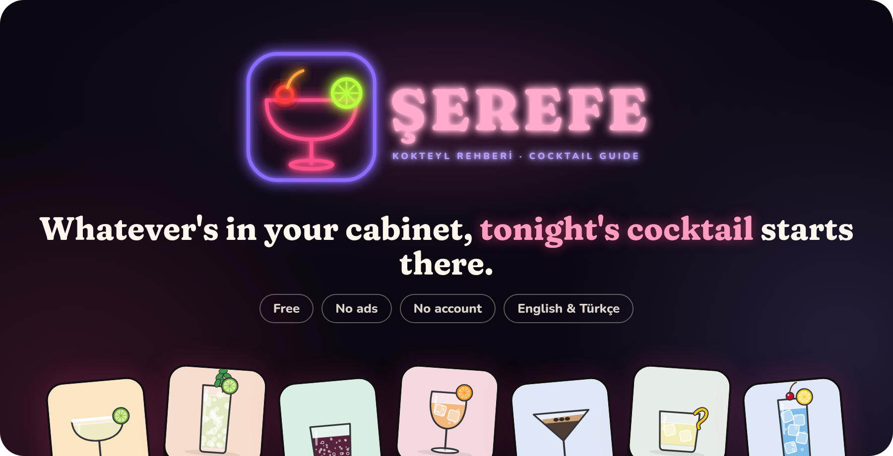
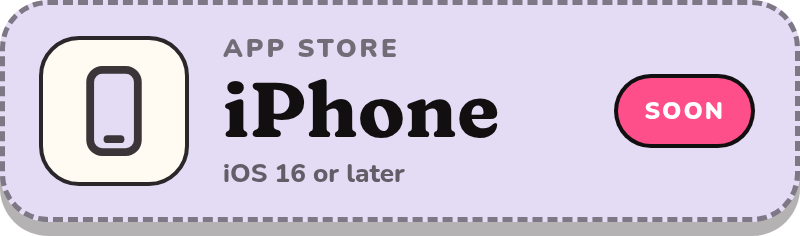
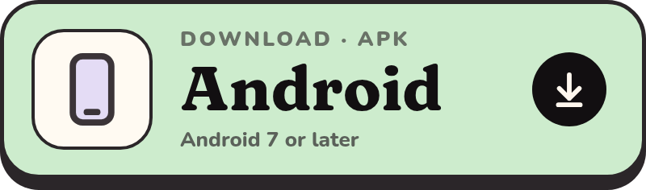
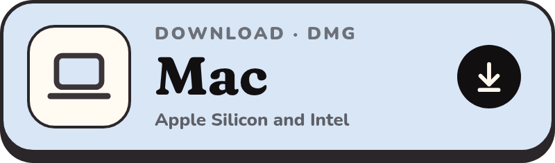
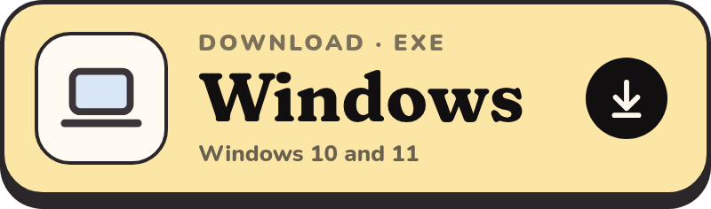
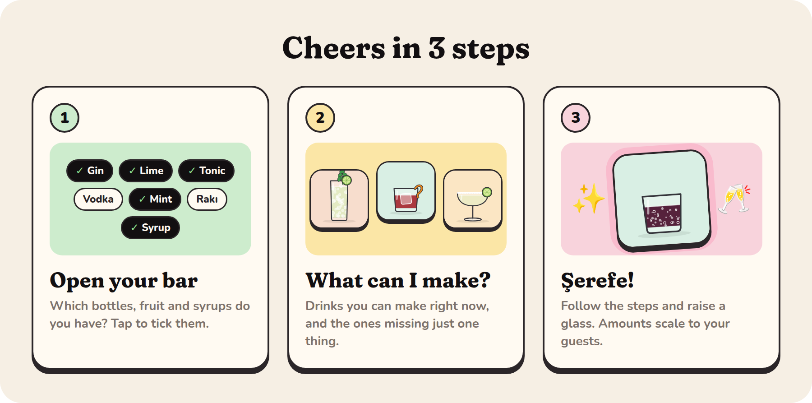
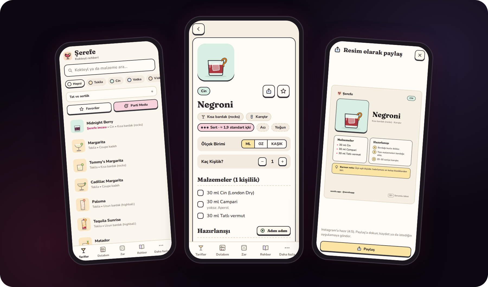
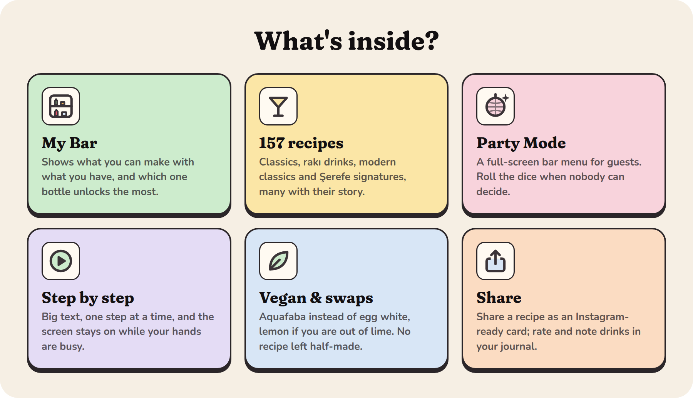

  

<a href="README.md">Türkçe</a> · <b>English</b>

Half a bottle of gin, a lime and some mint at home? **Şerefe** tells you what you can make tonight.
No memorising recipes, no bar kit, no sign-up: tick what's in your cabinet, pick a glass, cheers! 🥂

*(Şerefe is Turkish for "cheers".)*

## Download

  
  
   
  
  

> The first release is on its way; the buttons start working in early November. On a phone,
> **[serefe.app/indir](https://serefe.app/indir/)** recognises your device and shows the right file first.

  

  

  

### On your computer too

Made for house parties on a big screen: open Party Mode when friends arrive and leave the menu up.

<b>Seeing a warning on first launch?</b> (normal, you only confirm once)

 

Şerefe doesn't come from an app store yet, so your system asks once:

- **Android:** Open the file and allow installs from this source. If Play Protect asks, choose
  **More details → Install anyway**. New versions install over the old one and keep your data;
  the app tells you when one is out.
- **Mac:** Drag Şerefe to Applications. If it's blocked: **System Settings → Privacy & Security →
  Open Anyway**. If macOS says the app is damaged, run this once in Terminal:
  `xattr -cr /Applications/Şerefe.app`
- **Windows:** On "Windows protected your PC" choose **More info → Run anyway**.
- **iPhone:** it will install from the App Store once it's there.

<b>Where is my data?</b>

 

Only on your device. No account, no ads, no tracking; your favourites, bar and notes go nowhere.
Şerefe only goes online to check for a new version. Details: [serefe.app/gizlilik](https://serefe.app/gizlilik/)

## Got an idea?

A missing cocktail, a bug or a great idea… [Tell us here](https://github.com/alper4n/serefe-app/issues/new/choose)
or email [merhaba@serefe.app](mailto:merhaba@serefe.app). The vegan options came from a beta tester's suggestion. 🌱

  <a href="https://serefe.app">serefe.app</a> · <a href="https://www.instagram.com/serefeapp/">Instagram @serefeapp</a>
    
  <b>18+</b> · Please drink responsibly. Never drink and drive.

This repository is for downloads only; the app's source code is not public. © 2026 Şerefe. All rights reserved.
