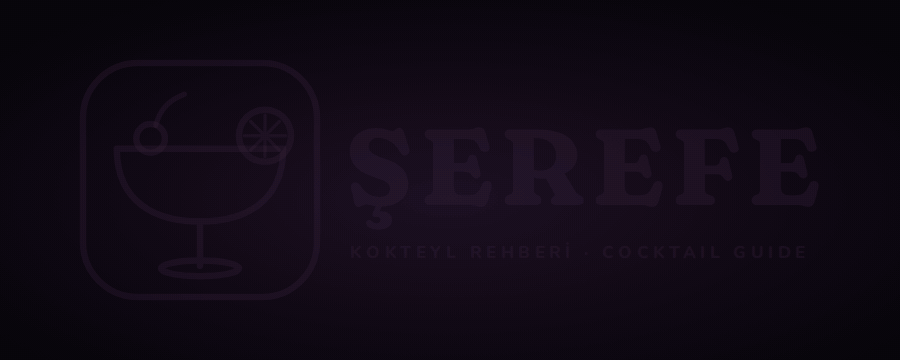
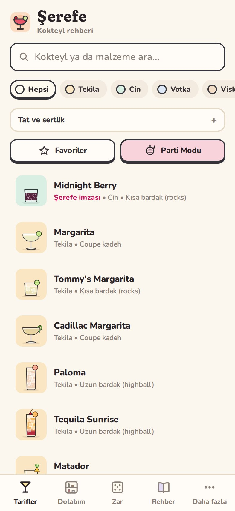
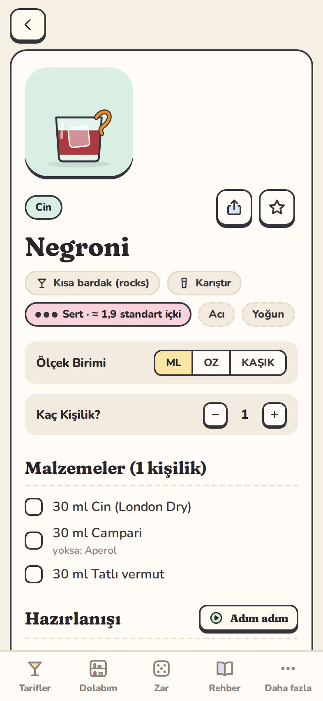
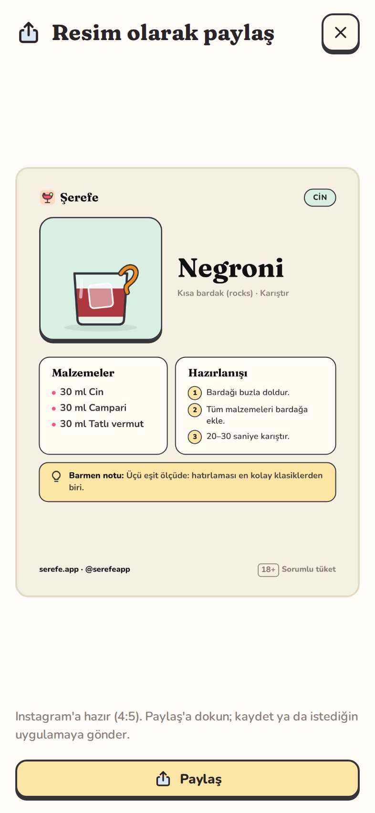
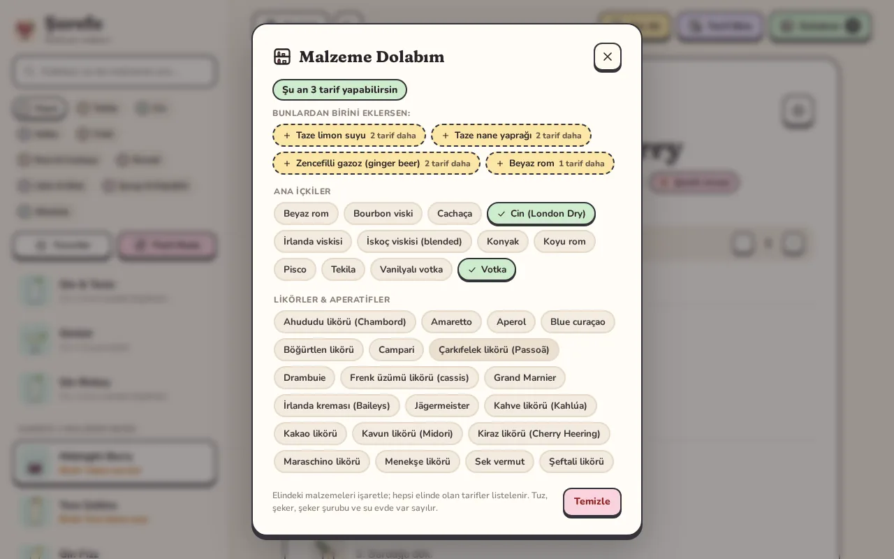
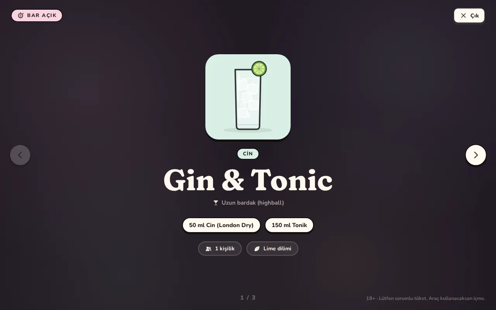

  

  <b>Evde kokteyl yapmanın en keyifli yolu.</b> 
  Dolabındaki şişeleri işaretle, şu an yapabileceğin kokteylleri gör. 
  Ücretsiz · Türkçe &amp; English · hesap yok, reklam yok

  🌐 <a href="https://serefe.app/indir/"><b>serefe.app/indir</b></a> ·
  <a href="https://serefe.app">serefe.app</a> ·
  <a href="https://www.instagram.com/serefeapp/">Instagram</a> ·
  <a href="#english">English</a>

## İndir

| Cihaz | Dosya | Gereksinim |
|---|---|---|
| Android | [Serefe-Android.apk](https://github.com/alper4n/serefe-app/releases/latest/download/Serefe-Android.apk) | Android 7 ve üstü |
| Mac | [Serefe-macOS.dmg](https://github.com/alper4n/serefe-app/releases/latest/download/Serefe-macOS.dmg) | macOS 11 ve üstü (Apple Silicon ve Intel) |
| Windows | [Serefe-Windows-setup.exe](https://github.com/alper4n/serefe-app/releases/latest/download/Serefe-Windows-setup.exe) | Windows 10 ve 11 |
| iPhone | App Store'da yakında | iOS 16 ve üstü |

> İlk sürüm hazırlanıyor; dosyalar yayınlanınca bağlantılar çalışır. Eski sürümler ve
> değişiklikler [Releases](https://github.com/alper4n/serefe-app/releases)'te.

### İlk kurulum

Şerefe şimdilik mağaza dışından dağıtıldığı için sistem bir kez uyarı gösterir:

- **Android:** Dosyayı aç. "Bilinmeyen kaynaklar" iznini ver; Play Koruma uyarısında
  **Yine de yükle**. Yeni sürüm eskisinin üstüne kurulur, verilerin silinmez. Uygulama yeni
  sürüm çıkınca kendisi haber verir.
- **Mac:** Şerefe'yi Uygulamalar klasörüne sürükle. İlk açılışta engellenirse
  **Sistem Ayarları → Gizlilik ve Güvenlik → Yine de Aç**.
- **Windows:** "Windows bilgisayarınızı korudu" çıkarsa **Ek bilgi → Yine de çalıştır**.

## Neler var?

- **Dolabım:** Evdeki şişeleri işaretle; hemen yapabileceklerini ve tek malzemesi eksik olanları gör.
- **150+ tarif:** Klasikler, modern klasikler, rakılılar ve Şerefe imzaları; her birinin kendi
  illüstrasyonu, adım adım hazırlanışı, tadı ve sertliği, birçoğunun hikâyesi.
- **Ne yoksa ne konur:** Eksik malzemeye uygun ikame önerileri.
- **Adım adım mod:** Bardağın başında büyük yazıyla, ekran kapanmadan.
- **Parti Modu:** Misafirler için tam ekran bar menüsü; ölçüler kişi sayısına göre ayarlanır.
- **Resim olarak paylaş:** Instagram'a hazır tarif kartı.
- **Defter:** Yaptıklarını işaretle, puan ver, not al.
- **Barmen rehberi:** Araçlar, teknikler, buz, bardaklar, şuruplar ve terimler.

  
  
  

  

  
  

## Gizlilik

Şerefe hiçbir kişisel veri toplamaz. Favorilerin, dolabın ve notların yalnızca cihazında
saklanır; hesap, takip ya da reklam yok. İnternete yalnızca yeni sürüm olup olmadığına bakmak
için çıkar.

## Hata ve öneri

[Issues](https://github.com/alper4n/serefe-app/issues) bölümünden bildir ya da
[merhaba@serefe.app](mailto:merhaba@serefe.app)'e yaz.

<b>18+</b> · Lütfen sorumlu tüket. Araç kullanacaksan içme.

---

## English

**The most fun way to make cocktails at home.** Tick the bottles in your cabinet and see what
you can make right now. Free, in Turkish and English, no account and no ads.

| Device | File | Requires |
|---|---|---|
| Android | [Serefe-Android.apk](https://github.com/alper4n/serefe-app/releases/latest/download/Serefe-Android.apk) | Android 7 or later |
| Mac | [Serefe-macOS.dmg](https://github.com/alper4n/serefe-app/releases/latest/download/Serefe-macOS.dmg) | macOS 11 or later (Apple Silicon and Intel) |
| Windows | [Serefe-Windows-setup.exe](https://github.com/alper4n/serefe-app/releases/latest/download/Serefe-Windows-setup.exe) | Windows 10 and 11 |
| iPhone | Coming soon to the App Store | iOS 16 or later |

> The first release is on its way; the links work once the files are published.

**First install** (shown once, since Şerefe isn't from an app store yet):

- **Android:** Open the file, allow "unknown sources" and choose **Install anyway** on the Play
  Protect prompt. New versions install over the old one and keep your data; the app tells you
  when one is out.
- **Mac:** Drag Şerefe to Applications. If the first launch is blocked: **System Settings →
  Privacy & Security → Open Anyway**.
- **Windows:** On "Windows protected your PC" choose **More info → Run anyway**.

**Inside:** My Bar, 150+ recipes (classics, modern classics, rakı drinks and Şerefe signatures)
with illustrations, steps, taste and strength, and many with their story; substitutions;
step-by-step mode; Party Mode; share as an image; a drinks journal; a bartender's guide.

**Privacy:** Şerefe collects no personal data. Everything stays on your device; it only goes
online to check for a new version.

**Feedback:** [Issues](https://github.com/alper4n/serefe-app/issues) or
[merhaba@serefe.app](mailto:merhaba@serefe.app).

<b>18+</b> · Please drink responsibly. Never drink and drive.

---

Bu depo yalnızca indirme ve tanıtım içindir; uygulamanın kaynak kodu açık değildir.
This repository is for downloads only; the app's source code is not public.
© 2026 Şerefe. Tüm hakları saklıdır · All rights reserved.
