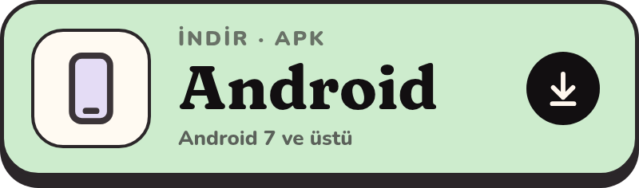
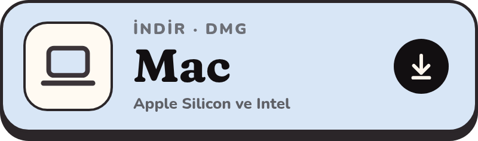
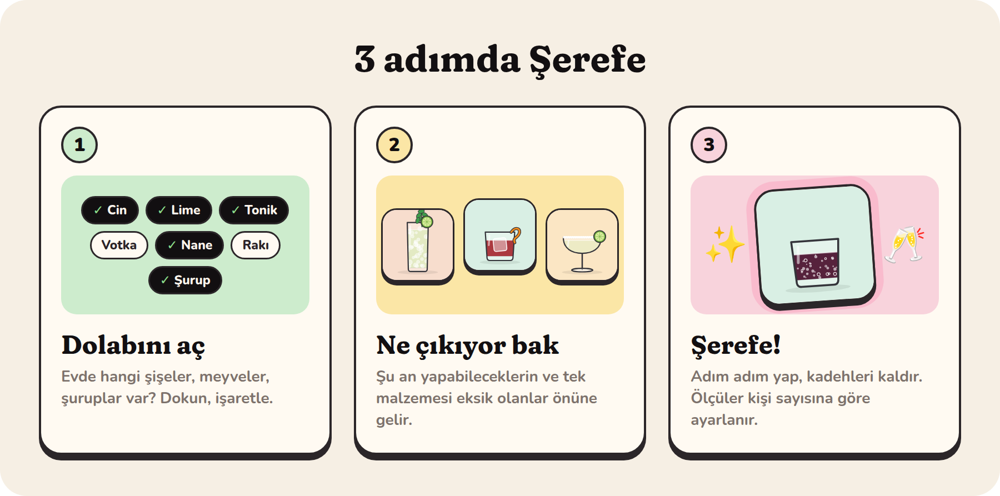
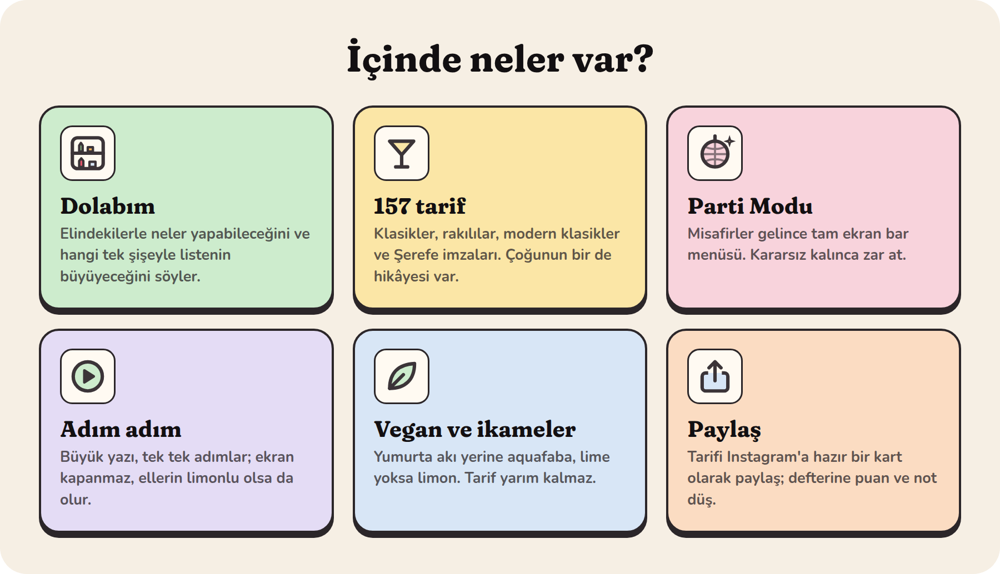
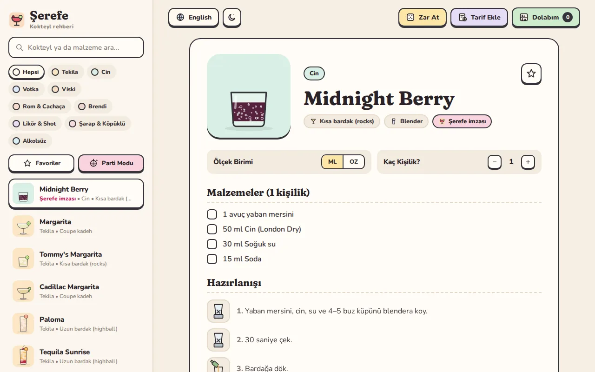

  

<b>Türkçe</b> · <a href=".github/english.md">English</a>

Evde yarım şişe cin, bir lime ve biraz nane mi var? **Şerefe** bu akşam ne yapabileceğini söyler.
Tarif ezberlemek, bar ekipmanı ya da hesap açmak gerekmez: dolabını işaretle, kadehini seç, şerefe! 🥂

## İndir

  
  
   
  
  

> İlk sürüm hazırlanıyor; düğmeler kasım başında çalışmaya başlar. Telefondan bakıyorsan
> **[serefe.app/indir](https://serefe.app/indir/)** cihazını tanır, doğru dosyayı en üstte gösterir.

  

  

  

### Bilgisayarda da

Büyük ekranda ev partisi için birebir: misafirler gelince Parti Modu'nu aç, menü ekranda dursun.

<b>İlk açılışta uyarı mı çıktı?</b> (normal, bir kez onaylaman yeter)

 

Şerefe şimdilik mağaza dışından geliyor, o yüzden sistem ilk seferde bir kez sorar:

- **Android:** Dosyayı aç, "Bu kaynaktan yüklemeye izin ver"i aç. Play Koruma sorarsa
  **Ayrıntılar → Yine de yükle**. Yeni sürüm eskisinin üstüne kurulur, verilerin silinmez;
  çıkınca uygulama sana haber verir.
- **Mac:** Şerefe'yi Uygulamalar klasörüne sürükle. Açılmazsa **Sistem Ayarları → Gizlilik ve
  Güvenlik → Yine de Aç**. "Hasarlı ve açılamıyor" derse Terminal'de bir kez şunu çalıştır:
  `xattr -cr /Applications/Şerefe.app`
- **Windows:** "Windows bilgisayarınızı korudu" çıkarsa **Ek bilgi → Yine de çalıştır**.
- **iPhone:** App Store'a gelince oradan kurulacak.

<b>Verilerim nerede?</b>

 

Sadece senin cihazında. Şerefe hesap istemez, reklam göstermez, seni takip etmez; favorilerin,
dolabın ve notların kimseye gitmez. İnternete yalnızca yeni sürüm var mı diye bakmak için çıkar.
Ayrıntılar: [serefe.app/gizlilik](https://serefe.app/gizlilik/)

## Fikrin mi var?

Eksik bir kokteyl, bir hata ya da harika bir fikir… [Buradan yaz](https://github.com/alper4n/serefe-app/issues/new/choose)
ya da [merhaba@serefe.app](mailto:merhaba@serefe.app)'e gönder. Vegan seçenekler de bir beta
kullanıcısının önerisiyle geldi. 🌱

  <a href="https://serefe.app">serefe.app</a> · <a href="https://www.instagram.com/serefeapp/">Instagram @serefeapp</a>
    
  <b>18+</b> · Lütfen sorumlu tüket. Araç kullanacaksan içme.

Bu depo yalnızca indirme ve tanıtım içindir; uygulamanın kaynak kodu açık değildir. © 2026 Şerefe. Tüm hakları saklıdır.
